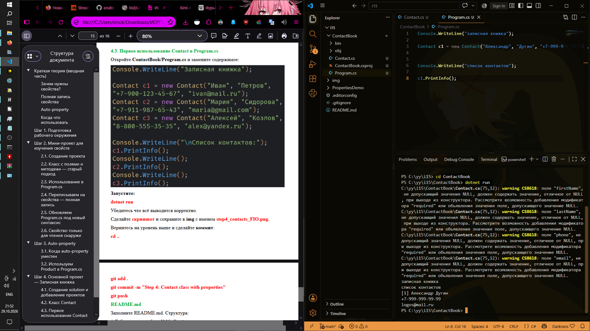
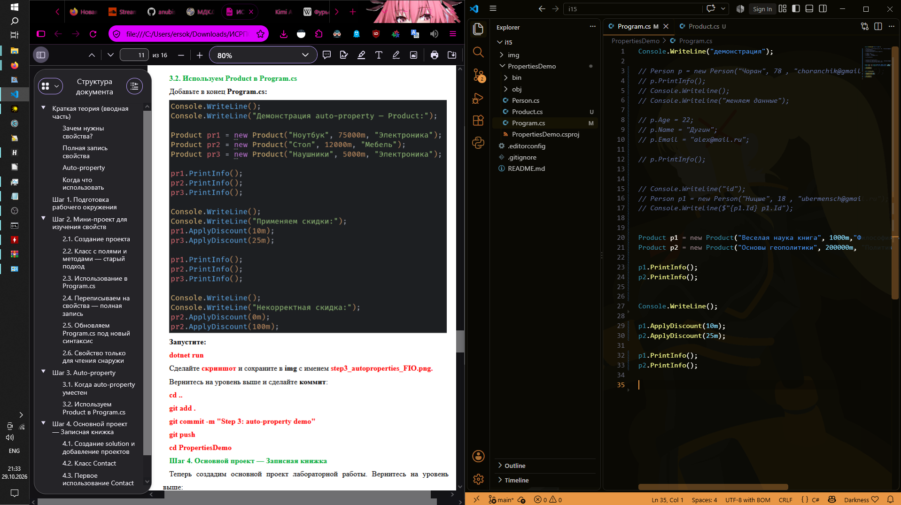

# ISRPO 15

___


**ФИО:** Чумаченко Михаил 
**Группа:** ИСП-242

___


## Описание работы
В ходе данной лабораторной работы были изучены механизмы инкапсуляции данных в языке C# с помощью свойств (properties). Было освоено различие между полями и свойствами, реализована валидация данных внутри блоков записи (set), а также применены сокращенные автосвойства (auto-properties) и свойства с ограниченным доступом на запись. Полученные знания были применены на практике при создании демонстрационного проекта и основного приложения «Записная книжка».

## Структура проекта

* **i15/**
* **PropertiesDemo/** — проект для первичного изучения свойств:
  * `Program.cs` — точка входа демонстрационного приложения, проверяющая работу валидации и автосвойств.
  * `Person.cs` — класс пользователя, содержащий полную запись свойств с валидацией имени, возраста и email.
  * `Product.cs` — класс товара, демонстрирующий применение различных видов автосвойств (включая read-only).

* **ContactBook/** — проект записная книжка:
    * `Program.cs` — основной исполняемый файл, выводящий список контактов на экран.
    * `Contact.cs` — класс контакта, инкапсулирующий персональные данные (имя, фамилию, телефон, email, заметки) при помощи свойств.


* **img/** — директория со скриншотами выполнения этапов работы.
* **.editorconfig** — файл конфигурации стиля кода с правилом размещения скобок на одной строке.
* **.gitignore** — файл исключений для системы контроля версий Git.

## Пример кода
Пример полноценного свойства с валидацией входящего значения (из класса `Person`):

```csharp
private int age;

public int Age {
    get {
        return age;
    }
    set {
        if (value < 0 || value > 150) {
            Console.WriteLine("ошибка");
            return;
        }
        age = value;
    }
}
```
___


## Выводы
1. **Свойства являются стандартом C#** для безопасного доступа к внутреннему состоянию объекта, заменяя собой громоздкие методы-геттеры и сеттеры (GetX/SetX), принятые в других языках (например, Java).
2. **Использование полной записи свойств с логикой в блоке `set`** позволяет гарантировать корректность данных (валидацию) на уровне класса не только при их последующем изменении, но и на этапе инициализации объекта через конструктор.
3. **Автосвойства (`{ get; set; }`) и модификатор `private set`** существенно сокращают исходный код программы в случаях, когда дополнительная валидация не требуется, помогая гибко разграничивать права доступа (например, запрещать изменение ID объекта из внешнего кода).


## Скриншоты


